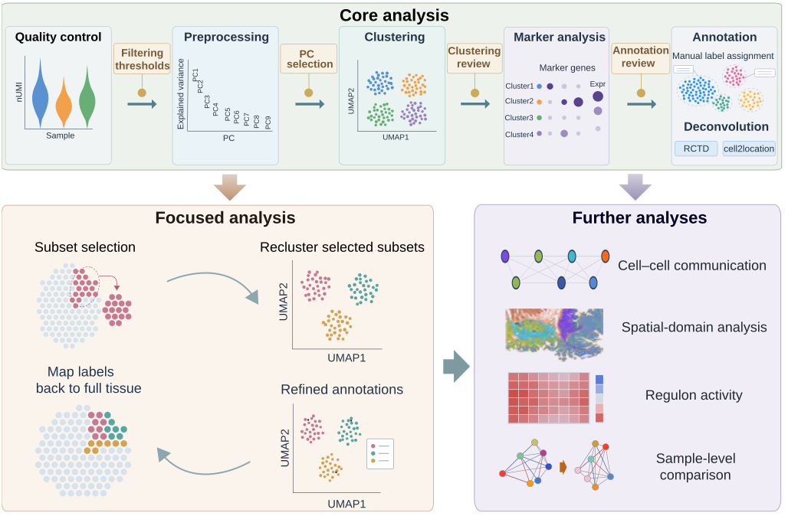

<p align="center">
  
</p>

<p align="center">
  
</p>

<p align="center">
  <a href="https://spatialsnake-tutorial.readthedocs.io/en/latest/">
    
  </a>
  <a href="https://pypi.org/project/spatialsnake/">
    
  </a>
  <a href="https://anaconda.org/bioconda/spatialsnake">
    
  </a>
  <a href="LICENSE"></a>
  <a href="https://anaconda.org/bioconda/spatialsnake">
    
  </a>
</p>

Spatialsnake is a command-line tool for analysing **processed spatial transcriptomics data** across sequencing- and imaging-based platforms. Built on SpatialData and Snakemake, it supports core analysis, focused analysis, further analyses and optional data operations.

<p align="center">
  
</p>

## Key features

- **Core analysis:** ingest supported platform outputs, review QC and dimensionality diagnostics, cluster observations, inspect markers or reference-based estimates, and store reviewed annotations. Compatible samples can share the core workflow while retaining sample and group identities.
- **Focused analysis:** select populations, ROIs or physical-distance neighborhoods; recluster selected observations and return refined labels to the parent object. Prepared subsets can proceed to downstream analyses.
- **Further analyses:** use BANKSY or CellCharter for spatial domains, CellPhoneDB/LIANA/CellChat for communication, and pySCENIC for regulatory programs. Sample-aware comparisons support pseudobulk gene analysis and CellChat comparisons. Supported communication plots can be regenerated from saved inference results.
- **Optional data operations:** split or merge compatible objects, import AnnData, and export AnnData or Seurat objects through the CLI. Saved stage inputs allow selected analyses to be revised without repeating unrelated preparation.

## Supported platforms

The `TYPE` values below are case-sensitive documented spellings. Platform-specific selectors determine the representation loaded for analysis.

| Platform / representation | CLI `TYPE` | Input |
| --- | --- | --- |
| Visium | `visium` | Processed expression matrix and spatial files |
| Visium HD | `visium_HD` | Space Ranger binned outputs; choose `bin_size` in the core sample table |
| Segmented Visium | `visium_segment` | Supported Space Ranger segmentation outputs |
| Stereo-seq | `stereoseq` | Supported SAW outputs; choose bin, cellbin or adjusted cellbin with `input_spec` |
| Xenium | `xenium` | Processed expression/transcript data and available images or cell geometries |
| MERFISH / MERSCOPE | `Merfish` | Supported Vizgen expression, transcript, boundary and image outputs |

Availability of images, transcripts and geometries depends on the platform files and loading settings. See the input documentation below for file requirements and resolution selection.

## Installation

For a basic installation on Linux with Conda:

```bash
conda create -n spatialsnake_env --override-channels -c conda-forge -c bioconda spatialsnake -y
conda activate spatialsnake_env
spatialsnake install-packages
```

See the [installation guide](https://spatialsnake-tutorial.readthedocs.io/en/latest/environment_setup.html) for PyPI and source installation, environment requirements, and optional analysis dependencies, including CPU/GPU choices.

## Command reference

| Entry point | Purpose |
| --- | --- |
| `single_analysis` / `compare_analysis` | Single-sample / multi-sample workflows |
| `useful_tool` | Splitting, merging and supported data conversion |
| `produce-file` | Generate a YAML template for a selected stage |
| `install-packages` | Complete dependencies for the selected installation route |

Use `spatialsnake --help` for available commands and parameters. Important parameters can be set directly on the command line; `--configfile` supplies additional YAML settings, with explicitly provided CLI values taking precedence. See the [command-line guide](https://spatialsnake-tutorial.readthedocs.io/en/latest/usage.html) and [configuration reference](https://spatialsnake-tutorial.readthedocs.io/en/latest/config_reference/index.html) for details.

## Documentation and support

- [Input preparation and supported representations](https://spatialsnake-tutorial.readthedocs.io/en/latest/data_input/index.html).
- [Core analysis](https://spatialsnake-tutorial.readthedocs.io/en/latest/core_analysis/index.html) and [multi-sample data assembly](https://spatialsnake-tutorial.readthedocs.io/en/latest/integration_analysis/multi_sample_integration.html).
- [Subclustering and annotation refinement](https://spatialsnake-tutorial.readthedocs.io/en/latest/subcluster_annotation/index.html).
- [Splitting, merging and data conversion](https://spatialsnake-tutorial.readthedocs.io/en/latest/useful_tool/index.html).
- [Downstream analysis and group comparisons](https://spatialsnake-tutorial.readthedocs.io/en/latest/downstream_analysis/index.html).
- **Problems or feature requests:** [GitHub issues](https://github.com/l-zh007/spatialsnake/issues). Include the software version, installation route, exact command, relevant YAML/sample table and error log. Omit credentials and private data.

## Citation

Report the Spatialsnake version and source revision used in your analysis. Please also cite the underlying SpatialData framework and Snakemake workflow engine:

- Marconato L, Palla G, Yamauchi KA, et al. **SpatialData: an open and universal data framework for spatial omics.** *Nature Methods*. 2025;22:58–62. [doi:10.1038/s41592-024-02212-x](https://doi.org/10.1038/s41592-024-02212-x).
- Mölder F, Jablonski KP, Letcher B, et al. **Sustainable data analysis with Snakemake.** *F1000Research*. 2021;10:33. [doi:10.12688/f1000research.29032.2](https://doi.org/10.12688/f1000research.29032.2).

For individual analytical methods, cite the corresponding original publications listed in the module documentation.

## License

Spatialsnake is distributed under the [MIT license](LICENSE).
